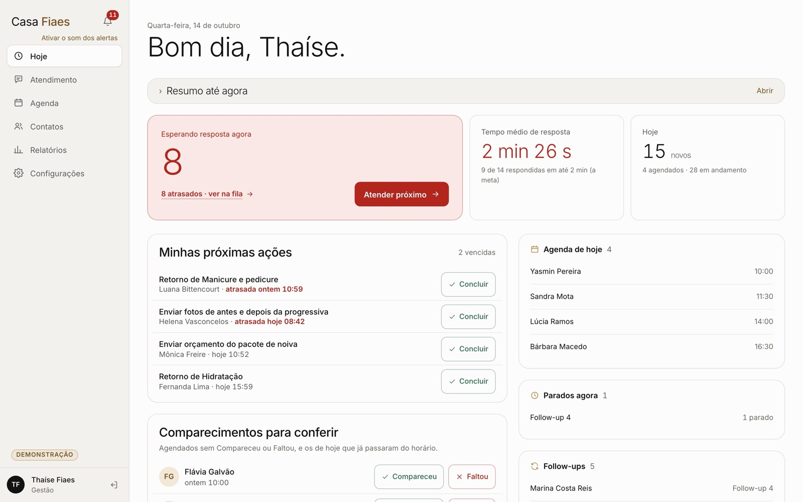
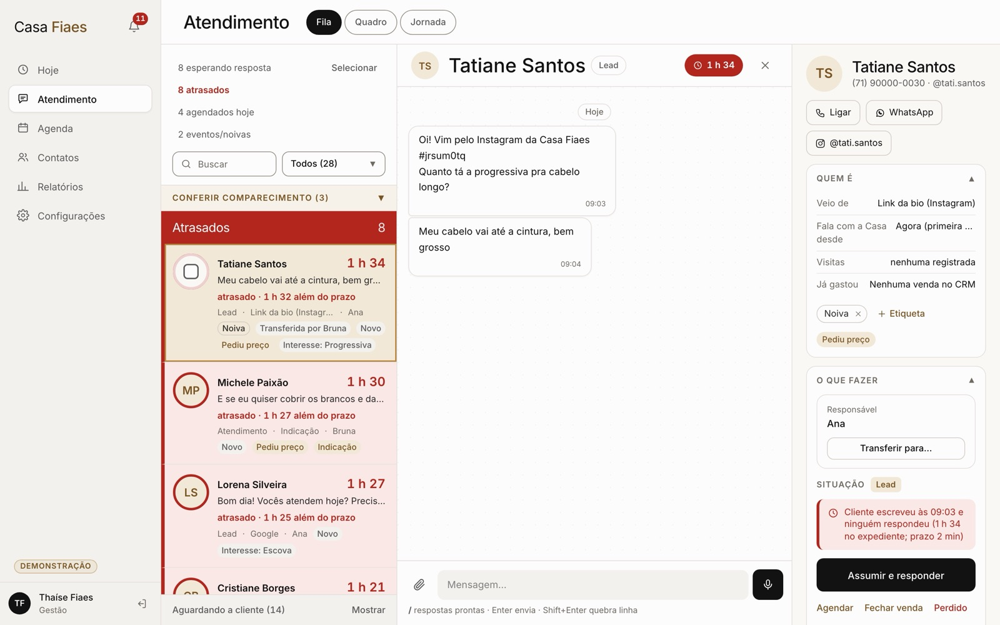
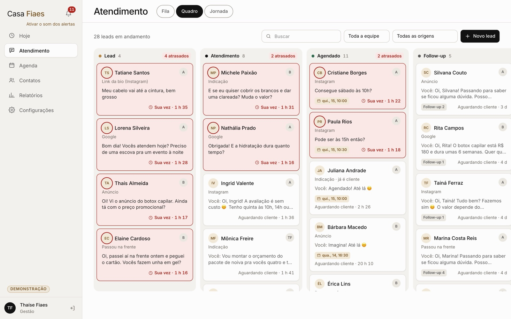
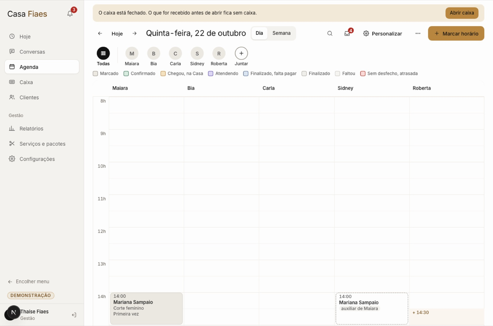
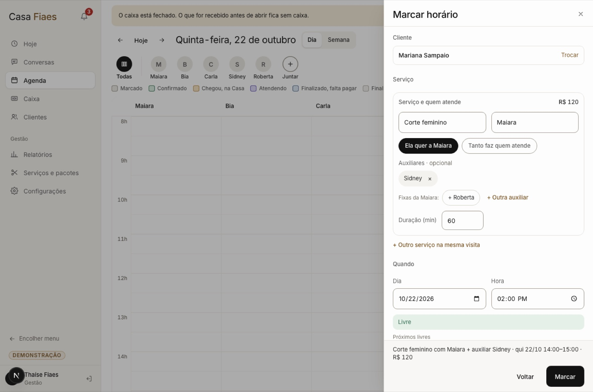
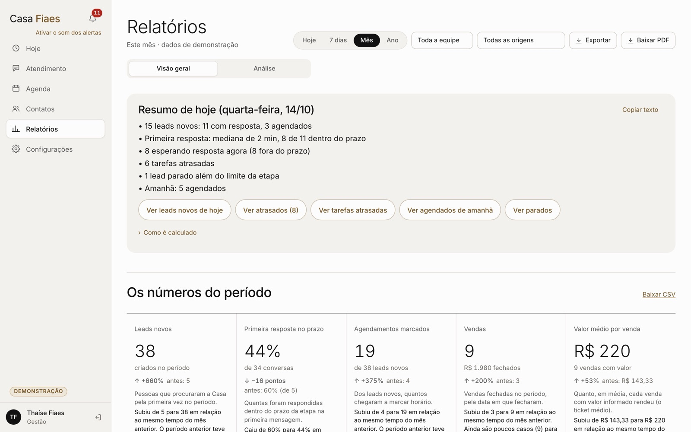
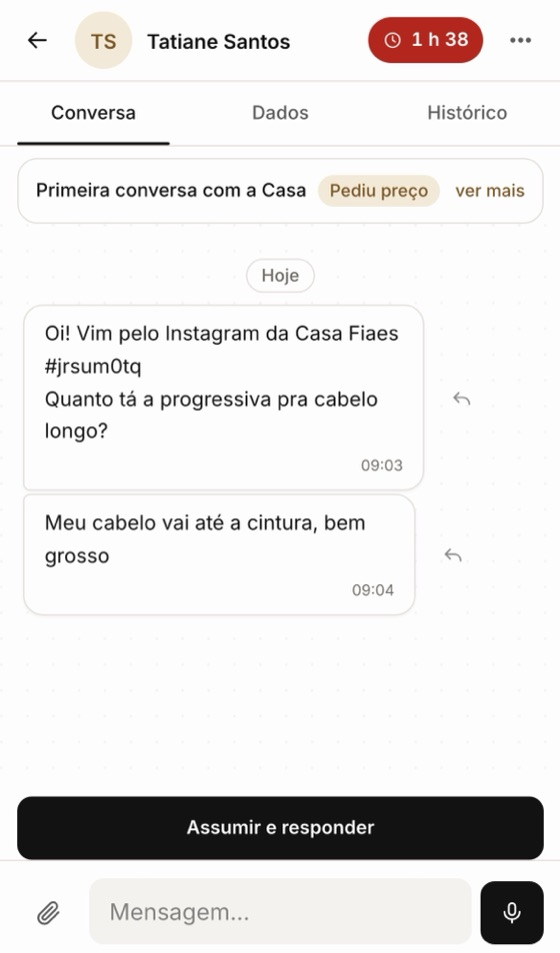
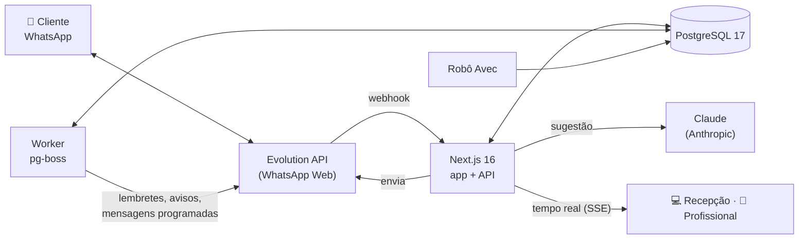

<div align="center">

# Casa Fiaes · CRM

**O WhatsApp do salão virou um sistema de atendimento.**
Toda mensagem vira conversa organizada, nenhuma cliente fica sem resposta,
a agenda conversa com o caixa e a IA escreve junto com a recepção.


<br>



</div>

---

## Por que existe

A Casa Fiaes é um salão em Salvador especializado em alongamento e projetos capilares. Todo o atendimento acontece pelo WhatsApp: orçamento, avaliação, agendamento, confirmação e pós-atendimento. Antes, isso vivia num celular e em três sistemas que não se falavam. Mensagem se perdia, cliente esperava horas e ninguém sabia quem estava atendendo quem.

Este CRM junta tudo num lugar só e responde a uma pergunta o dia inteiro: **quem precisa de mim agora?**

> Ele está em produção desde outubro de 2026 e é usado todo dia pela recepção, pelas profissionais e pela gestão. Cada tela foi ajustada com a equipe trabalhando nela.

---

## O que ele faz

### 💬 Atendimento
- **Toda conversa do WhatsApp vira um lead automaticamente**, com origem identificada (Instagram, Google, indicação, link com código).
- **Fila por urgência:** atrasados no topo, contagem do tempo de espera em horário comercial e "Próximo da fila" depois de responder.
- **Quadro** com as etapas do funil (arrastar e soltar) e **Jornada** do primeiro contato até a venda.
- Conversa completa: respostas prontas com `/`, áudio, anexos, citação, reação, editar, **encaminhar**, apagar para todos ou só no CRM, e ligações registradas.
- **Mãe e filha no mesmo número:** cada pessoa tem ficha, horários e lembretes próprios, numa conversa só.
- "Sara está escrevendo…": duas atendentes não respondem a mesma cliente ao mesmo tempo.

### ✨ IA que escreve junto (e nunca envia sozinha)
- **Sugestão de resposta** com Claude, no tom da Casa, com os horários livres de verdade da agenda e o serviço certo de cada profissional.
- **"Sobre o quê?"**: a atendente diz o que quer, por texto ou **ditando um áudio**, e a IA monta a mensagem.
- Quando a cliente cancela sem nova data, a IA **propõe uma retomada** em 15 a 30 dias. Só vira tarefa se alguém tocar.
- Pós-processamento que corta jeito juvenil, repetição e texto quebrado. Cada sugestão fica registrada com custo e modelo.

### 📅 Agenda, comanda e caixa
- Agenda por profissional, **com auxiliares** que ocupam a agenda delas, encaixe, bloqueios, recorrência e lista de espera.
- **Marcar horário** em blocos: cliente, serviços, quando e mais opções, com resumo no rodapé e o preço visível só para quem pode ver valores.
- Chegou → **comanda da visita** com todos os serviços, comissões, pacotes, créditos e débitos.
- **Nota fiscal** (NFS-e nacional e NFC-e) e **estoque** com baixa automática.
- **Link da cliente** para confirmar, remarcar ou agendar online, e o app da profissional no celular.

### 🔔 Ninguém fica esquecida
- Avisos em degraus: selo → vermelho → gestão. **Um aviso por conversa e por motivo**, sem enxurrada.
- Combinados ("retomar dia 25") com data, lembrete e mensagem programada.
- Lembrete de horário organizado para WhatsApp, com data e hora em destaque.
- Push no celular, som e título da aba. Se o WhatsApp cair, a gestão é avisada na hora.

### 📊 Gestão
- **Relatórios** com drill-down: cada número abre a lista de clientes por trás dele. Exporta CSV e PDF.
- Perfis e permissões por função (recepção, atendente, profissional, gestão).
- Automações editáveis no formato "Quando / Se / Então". **Toda automação que envia mensagem nasce desligada.**
- Importação do Avec (robô que sincroniza a agenda), do ChatGuru e do histórico do WhatsApp.

---

## Telas

<table>
<tr>
<td width="50%"><br><sub><b>Fila + conversa + painel da cliente</b>: quem espera, há quanto tempo e o que fazer.</sub></td>
<td width="50%"><br><sub><b>Quadro</b>: o funil inteiro, com quem está atrasado em vermelho.</sub></td>
</tr>
<tr>
<td><br><sub><b>Agenda por profissional</b>: a auxiliar aparece na coluna dela, ligada à principal.</sub></td>
<td><br><sub><b>Marcar horário</b>: serviço, quem atende, auxiliares, duração, encaixe e resumo.</sub></td>
</tr>
<tr>
<td><br><sub><b>Relatórios</b>: o resumo do dia em texto e os números do período.</sub></td>
<td align="center"><br><sub><b>No celular</b>: a mesma Fila, feita para o polegar.</sub></td>
</tr>
</table>

<sub>Todas as telas usam o banco de demonstração. Nomes, telefones e números são fictícios.</sub>

---

## Princípios

| | |
|---|---|
| **A IA sugere, a pessoa envia** | Nenhuma mensagem sai sem alguém tocar em Enviar. A IA nunca cria tarefa, horário ou envio sozinha. |
| **Nada some em silêncio** | Falha de envio, WhatsApp desconectado e mensagem que não chegou viram aviso visível. O pior erro é o que ninguém vê. |
| **Uma pergunta e uma ação por tela** | A recepção atende dezenas de conversas por dia. Cada tela tem uma decisão clara, sem jargão. |
| **Tudo é reversível e auditado** | Mudança de etapa, transferência, arquivar e unir cadastros têm Desfazer e ficam no histórico com quem fez e quando. |
| **Os dados ficam com a Casa** | Servidor próprio, banco próprio e backup diário com teste de restauração. |

---

## Como funciona



- **App (Next.js, App Router):** telas, server actions e API. As regras de negócio ficam em `src/server/domain`, sem React.
- **Worker (pg-boss):** automações, avisos em degraus, mensagens programadas, push, reprocessamento de webhooks e limpeza.
- **Evolution API:** conexão com o WhatsApp do salão, lendo um QR code como no WhatsApp Web.
- **Tempo real:** Server-Sent Events. Quando uma atendente responde, a Fila de todas atualiza.

| Camada | Tecnologia |
|---|---|
| Interface | React 19, Tailwind CSS, Motion |
| Servidor | Next.js 16, Zod, Drizzle ORM |
| Banco | PostgreSQL 17, quase 90 migrações versionadas |
| Filas | pg-boss (no próprio Postgres) |
| WhatsApp | Evolution API 2.3 |
| IA | Claude Sonnet (sugestão), Whisper local (transcrição) |
| Testes | Vitest (5.000+ testes em 700+ arquivos) e Playwright (desktop, iPhone e acessibilidade com axe) |
| Produção | VPS próprio, pm2, Caddy (HTTPS), backup diário |

---

## Rodar localmente

Requisitos: **Node 20.9+** e **Docker** (Colima ou Docker Desktop).

```bash
cp .env.example .env          # ajuste EVOLUTION_API_KEY, WEBHOOK_SECRET e SESSION_SECRET
npm install
npm run infra:up              # Postgres 17 + Evolution API
npm run db:migrate            # cria as tabelas
npm run db:seed               # etapas, listas, respostas prontas e automações padrão (todas desligadas)
npm run seed:admin -- --email voce@exemplo.com --name "Seu nome"
npm run dev                   # http://localhost:3000
npm run worker                # em outro terminal
```

**Sem WhatsApp pareado?** Ligue `DEV_TOOLS=true` e use o simulador em `/dev/simulador`. Em produção ele fica sempre desligado.

**Quer ver com dados?** `npm run demo:seed && npm run demo:start` sobe a demonstração com clientes, conversas e agenda fictícias.

Todas as variáveis estão comentadas no [`.env.example`](.env.example).

---

## Testes

```bash
npm test                      # Vitest: domínio, regras, webhook, IA, relatórios, agenda, caixa
npm run e2e                   # Playwright: desktop 1440, iPhone 13 e axe
npm run typecheck
npm run checar:journal        # confere a ordem das migrações
```

Os testes usam bancos separados (`crm_test`, `crm_e2e`) e nunca chamam o WhatsApp nem a IA de verdade.

---

## Estrutura

```
src/
  app/            rotas: (app) telas da equipe · (pro) app da profissional · c/ link da cliente · agendar/ · api/
  components/     design system (ui/) e telas: queue (Fila e conversa), lead, agenda, caixa, pipeline, reports…
  server/
    domain/       regras de negócio: leads, agenda, caixa, fiscal, estoque, avec, alertas, envios…
    ai/           sugestão de resposta: prompt, contexto, horários, pós-processamento, ditado
    whatsapp/     Evolution API e webhook
    rules/        motor de automações
    queries/      leituras das telas (Fila, Quadro, Hoje, relatórios)
  lib/            utilitários compartilhados entre cliente e servidor
worker/           processo separado (pg-boss)
drizzle/          migrações SQL versionadas
scripts/          backup, restauração, seeds, demonstração, robô do Avec
e2e/              testes de ponta a ponta
docs/             especificações, decisões, deploy e backup
```

---

## Operação

- **Deploy sem derrubar ninguém:** o build roda numa pasta nova, as migrações são aditivas e rodam antes da troca, e a troca leva segundos. Quem está com o CRM aberto vê **"Versão nova do CRM. Atualizar"** em vez de um erro, e o texto que estava digitando não se perde.
- **Janela de atualização** combinada com a equipe: fora do horário de atendimento.
- **Backup diário** do banco, da mídia e da sessão do WhatsApp, com teste de restauração. Veja [`docs/backup-restauracao.md`](docs/backup-restauracao.md).
- **Saúde:** `/api/health` mostra o banco, o heartbeat do worker e cada número do WhatsApp.
- **Segurança:** CSP com nonce, mídia servida isolada, rate limit por IP, sessões assinadas e permissões por perfil em toda ação do servidor.

---

## Sobre os dados deste repositório

Este é o código do sistema, **sem nenhum dado real**. Telefones e nomes que aparecem em testes e documentos são fictícios, e segredos ficam só no servidor (veja o `.env.example`).

## Licenças de terceiros

Integra com a [**Evolution API**](https://github.com/evolution-foundation/evolution-api) (Apache 2.0 com condição de atribuição).

<div align="center">
<br>
<sub>Feito para a <b>Casa Fiaes</b> · Salvador, Bahia</sub>
</div>
